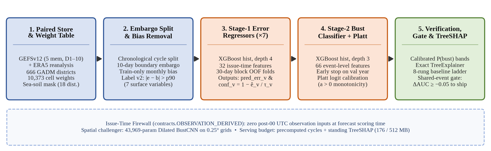
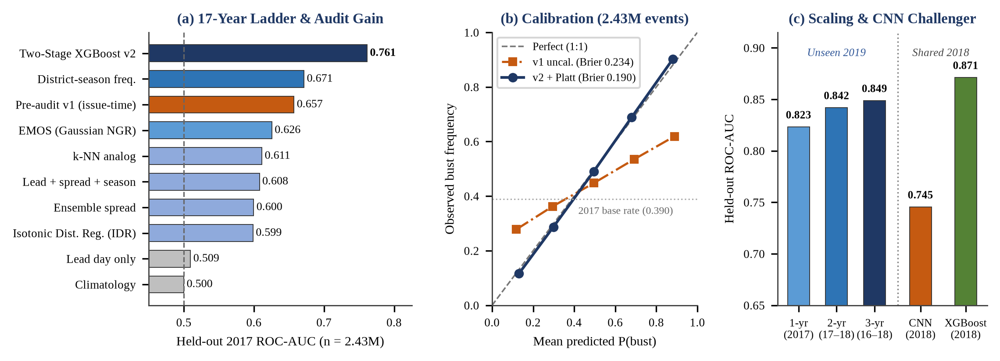
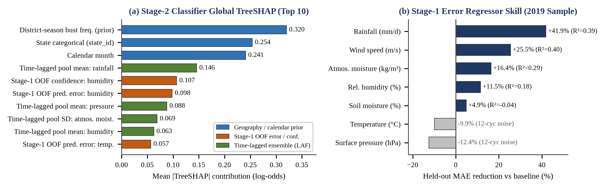

# Methodology and Model Performance Report

**Explainable AI for District-Level Prediction of Medium-Range Weather Forecast Busts over India**

DN Harith, Dhanush Thota | Dept. of AI & ML, Dayananda Sagar College of Engineering  
Faculty Guide: Prof. Kusumika Krori Dutta | November 18, 2026

---

## Summary

This report documents how the Sanket medium-range forecast-bust early-warning model was
constructed, audited for post-issue leakage, and evaluated across India's 666 GADM 4.1
districts over Day 1–10 lead times. Rather than replacing numerical weather prediction
(NWP), Sanket treats forecast failure as a supervised reliability problem: seven
per-variable XGBoost error regressors (Stage 1, out-of-fold over 30-day cycle blocks) feed
a Platt-calibrated XGBoost bust classifier (Stage 2) paired with exact TreeSHAP
attributions. Trained on 17 years of NOAA GEFSv12 five-member reforecasts verified against
ERA5 reanalysis (2000–2016; 6,193 cycles) with a 10-day boundary embargo and evaluated
strictly as of 00 UTC issue time on all 365 unseen cycles of 2017 (2,430,900
district-day-lead events; base rate 38.95%), the promoted Label-v2 model
(`run_20261006T200800Z`) achieves ROC-AUC **0.7615** (+0.1043 over the pre-audit
deployment's honest issue-time 0.6572), PR-AUC **0.6784**, Brier score **0.1898** (Brier
Skill Score **+0.2019** vs climatology), and F1 **0.5819**. It outperforms every rung of an
eight-baseline verification ladder (climatology 0.5000, ensemble spread 0.5996, EMOS
0.6256, district-season frequency 0.6715) and beats a 43,969-parameter dilated
convolutional neural network (`BustCNN`) by 0.126–0.163 ROC-AUC across two independent
years. Important caveats remain: 17-year Label-v2 evaluation covers a single primary test
year (with 2018–2019 cross-checked in multi-year experiments), archive spread comes from 5
of 31 GEFS members, and ERA5-versus-MERRA-2 reanalysis disagreement spans 23.5–43.5% of
the bust threshold itself.

---

## 1. Methodology

### 1.1 Problem and design

Medium-range NWP ensembles occasionally suffer synoptic-scale failures ("forecast busts")
where realised weather departs sharply from ensemble mean guidance even when member spread
appears modest [2]. For district $d$, surface variable $v$, initialization cycle $t_0$, and
lead day $l \in \{1, \dots, 10\}$ (valid date $t = t_0 + l - 1$), let
$e_{d,v,l} = |\mu_{d,v,l} - y_{d,v} - b_{d,v,l,m}|$ denote the bias-corrected
ensemble-mean absolute error, where $b_{d,v,l,m}$ is the standing monthly bias estimated
strictly on training cycles. A variable-level bust occurs when $e_{d,v,l} > \tau_v$ (the
90th percentile of training errors for variable $v$), and an event-level bust occurs if
any of the seven modelled surface variables busts on that $(d, t_0, l)$ triple. The
pipeline estimates calibrated $P(\text{bust})$ and decomposes each district-lead score into
additive feature contributions via TreeSHAP [1, 10].

*Figure 1. Two-stage leakage-free bust prediction, Platt calibration, and TreeSHAP attribution pipeline.*

### 1.2 Data

| Item | Description |
|---|---|
| Sources | NOAA GEFSv12 00 UTC reforecast (2000–2019, 0.25°, 5 members: `gec00`, `gep01–04`) [3] paired with Copernicus ERA5 hourly reanalysis [4] aggregated to UTC daily district means; static geography from GADM 4.1 (666 districts) and CGIAR-CSI SRTM v4 elevation. |
| Archive scale | 7,288 of 7,305 daily cycles ingested (242,690,400 district-member-lead rows; 1.30B variable-value cells). Promoted v2 run spans 2000–2017 (6,558 cycles). Reproducible repository sample: 17 cycles of 2019 across 36 capitals (30,600 forecast + 13,680 ERA5 rows; 5,950 scored events). |
| Predictors | 32 issue-time features per Stage-1 regressor (forecast value, 5-member spread, member count, time-lagged ensemble pool mean/SD/size/ratio, cycle-to-cycle jumpiness, pressure/moisture rates, 5 GADM/SRTM descriptors, concurrent variables, state, season); 66 features in Stage 2. |
| Target (Label v2) | Binary indicator $y_{\text{bust}} \in \{0, 1\}$ that $\ge 1$ of 7 bias-corrected surface variables exceeds its training-only 90th-percentile error $\tau_v$. Held-out 2017 base rate: 38.95% (946,820 / 2,430,900 events); 2019 sample test base rate: 39.81% (418 / 1,050). |
| Regime contrast | Monsoon (JJAS) aggregate bust rate reaches 48.6% versus 28.5% in post-monsoon/winter; rainfall error p90 jumps from 4.0 mm/day outside JJAS to 15.9 mm/day during JJAS. |

### 1.3 Data cleaning and audit cautions on the input store

- **Structural horizon caps vs corrupt values:** Observation parquets contain zero nulls. On the forecast side, 10 m wind components terminate at 120 h (Day 5) and topsoil moisture at 72 h (Day 3) in AWS GEFSv12; absence at longer leads is structural and never imputed. Two corrupt member-days in 20 years (e.g., 2004-03-05 `gep02` encoding ~10⁵ K) are stripped at ingestion by physical range bounds (`PLAUSIBLE_RANGE`), and any cycle short of 33,300 rows is quarantined.
- **Coastal sea-value soil contamination:** Coarse GEFS land-sea masks report 98–100% volumetric water over ocean cells while ERA5 masks them to 0%, fabricating 100% bust rates in island and coastal districts (Lakshadweep, Nicobar, Mahe, Yanam). Building `soil_land_mask.parquet` masks soil moisture on both sides for all 18 districts with >5% GEFS sea weight.
- **Standing district bias and circular wind:** Variance decomposition (2026-09-25 audit) showed that 64% of temperature/humidity squared error and 90% of soil-moisture squared error is fixed district bias. Label v2 subtracts training-only `(district, variable, lead, month)` bias before computing $\tau_v$, cutting November 2017 humidity p90 from 27.6 to 10.4 %RH, and excludes wind direction from the label after circular wrap-around reduction (191.0° → 115.1° p90).
- **Post-issue leakage and dedupe hygiene:** Auditing `run_20260922T043925Z` revealed that `forecast_error_lag` read realised lead $k-1$ error unavailable for Days 2–10 at 00 UTC (inflating test ROC-AUC from 0.6572 live to 0.8435 offline), while late-ingested IMD rainfall batches had overwritten ERA5 on 2016–2019 via timestamp dedupe despite a 1-day IST/UTC offset ($r = 0.753$ shifted vs $0.442$ unshifted). Both paths are now hard-blocked by `contracts.OBSERVATION_DERIVED` and batch quarantine; stale 106-day-lag OMI MJO indices (0.0% SHAP weight) were also removed.

### 1.4 Predictand variables, lead horizons and bust thresholds

| Variable | Unit | GEFS Lead | Pipeline Role | Raw p90 (v1) | Bias-Corr. p90 (v2 / 2019) |
|---|---|---|---|---:|---:|
| Rainfall (`apcp_sfc`) | mm/day | Day 1–10 | Label + Stage 1/2 input | 9.33 | 9.33 / 15.01 |
| 2 m Temperature (`tmp_2m`) | °C | Day 1–10 | Label + Stage 1/2 input | 2.86 | 1.85 / 2.42 |
| 2 m Rel. Humidity (`spfh`/`d2m`) | % | Day 1–10 | Label + Stage 1/2 input | 27.65 | 10.40 / 13.94 |
| Surface Pressure (`pres_sfc`) | hPa | Day 1–10 | Label + Stage 1/2 input | 2.30 | 1.62 / 2.70 |
| Atmos. Moisture (`pwat_eatm`) | kg/m² | Day 1–10 | Label + Stage 1/2 input | 7.52 | 6.10 / 6.33 |
| 10 m Wind Speed (`u10`, `v10`) | m/s | Day 1–5 | Label + Stage 1/2 input | 1.72 | 1.48 / 1.73 |
| Topsoil Moisture (`soilw`) | % | Day 1–3 | Label + Stage 1/2 input (masked) | 16.69 | 6.85 / 7.72 |
| 10 m Wind Direction | deg | Day 1–5 | Predictor input only (circular) | 137.44 | Excluded from v2 label |
| Z500, CAPE, CIN | m, J/kg | Day 1–10 | 0.25° `BustCNN` grid channels only | — | Spatial challenger only |

*Table 1. Meteorological variables, archive lead coverage, pipeline roles, and training-only 90th-percentile thresholds.*

### 1.5 Preprocessing and leakage-free splitting

Both forecast and reanalysis grids pass through the exact same 10,373-pair polygon-cell
area-overlap weight table (`district_grid_weights.parquet`), preventing coast/orography
interpolation mismatch. Under ERA5 estimator v2, derived quantities (Bolton relative
humidity and vector wind speed/direction) are computed *after* daily and district
averaging. Tree models consume native IEEE-754 `NaN` values without imputation, and natural
class priors (~39% bust) are preserved without synthetic resampling or `scale_pos_weight`.

All splits operate strictly on forecast initialization timestamps (`init_date`) with a
**10-day boundary embargo** (`SPLIT_EMBARGO_DAYS = 10`). In the 17-year promoted run,
2000–2015 forms the training pool (5,828 cycles; Stage-1 regressors fit on a fixed-seed
2,000-cycle sample), 2016 (365 cycles) serves as validation, and all 365 cycles of 2017
(2,430,900 events) form the held-out test set. Inside training, Stage-1 out-of-fold
predictions use $K = 5$ contiguous 30-day cycle blocks with 10-day embargoes on both edges.

### 1.6 Two-stage XGBoost, Platt calibration, CNN challenger and TreeSHAP

Stage 1 fits one histogram-binned `XGBRegressor` per variable $v$ to predict
bias-corrected absolute error $\hat{e}_{d,v,l}$ and normalized confidence
$\text{conf}_v = \text{clip}(1 - \hat{e}_{d,v,l}/\tau_v, 0, 1)$, augmenting 5-member spread
with lagged-average forecast pooling (`laf_*`) and cycle-to-cycle jumpiness (`jump_*`).
Stage 2 fits a regularised `XGBClassifier` over 66 event-level features, calibrated on
validation logits via monotone Platt scaling ($p' = \sigma(a \cdot \text{logit}(p) + b)$,
$a > 0$) and explained via exact `shap.TreeExplainer` [10]. The spatial challenger
`BustCNN` applies four dilated `Conv2d` blocks (dilations 1, 2, 4, 8; 43,969 parameters)
over $145 \times 141 \times 48$ tensors with parameter-free sparse `DistrictPooling`.

### 1.7 Models and baselines compared

- **Two-stage XGBoost + Platt (`run_20261006T200800Z`):** promoted Label-v2 / Feature-v2 model scored strictly at 00 UTC issue time.
- **Pre-audit Two-stage XGBoost (`run_20260922T043925Z`):** Label-v1 uncalibrated deployment scored both offline (lag populated) and honestly as of issue time.
- **Candidate tabular baselines:** Single-stage XGBoost (no Stage-1 OOF), Random Forest (300 trees, depth 8), and L2 Logistic Regression.
- **Spatial challenger (`BustCNN`):** 1-seed and 3-seed dilated CNN ensembles on 2017 and 2018 cycles.
- **Eight-rung statistical ladder:** Climatology, District-Season Frequency, Lead Day, Ensemble Spread, Lead+Spread+Season, EMOS / Gaussian NGR [5], Isotonic Distributional Regression (IDR), and $k = 25$ Analog.

### 1.8 Evaluation protocol

Metrics cover trapezoidal ROC-AUC, NCMRWF binormal Z-AUC [7], PR-AUC, Brier score, Brier
Skill Score ($\text{BSS} = 1 - \text{BS}/\text{BS}_{\text{clim}}$), CORP reliability
decomposition ($\text{BS} = \text{MCB} - \text{DSC} + \text{UNC}$) [6], thresholded
accuracy, balanced accuracy, sensitivity, specificity, precision, F1, SEDI, split conformal
coverage ($\alpha = 0.10$), and 1,000-resample 30-day circular block bootstraps over
forecast cycles.

---

## 2. Model Performance

### 2.1 Stage-1 per-variable error regressors and candidate tabular models

| Stage-1 Variable | $\tau_v$ (p90) | Val MAE | Test MAE | Base MAE | Test $R^2$ | Top TreeSHAP Driver (\|SHAP\|) |
|---|---:|---:|---:|---:|---:|---|
| Rainfall (mm/day) | 15.01 | 5.29 | 2.93 | 5.04 | 0.395 | `forecast_value` (3.22) |
| 10 m Wind speed (m/s) | 1.73 | 0.47 | 0.40 | 0.54 | 0.398 | `forecast_value` (0.17) |
| Atmos. moisture (kg/m²) | 6.33 | 2.18 | 2.59 | 3.10 | 0.290 | `ensemble_spread` (0.85) |
| 2 m Rel. humidity (%) | 13.94 | 3.05 | 4.50 | 5.08 | 0.185 | `forecast_value` (2.23) |
| Soil moisture (%) | 7.72 | 2.16 | 3.11 | 3.27 | -0.040 | `state_id` (0.72) |
| 2 m Temperature (°C) | 2.42 | 0.64 | 0.82 | 0.74 | 0.000 | `forecast_value` (0.22) |
| Surface pressure (hPa) | 2.70 | 0.76 | 0.88 | 0.78 | 0.203 | `forecast_value` (0.33) |

*Table 3a. Stage-1 per-variable XGBoost error regressor performance on the chronological 2019 sample split.*

| Candidate Model (2019 Sample) | Acc. | Bal. Acc. | Sens. | Spec. | F1 | ROC-AUC | PR-AUC | Brier ↓ |
|---|---:|---:|---:|---:|---:|---:|---:|---:|
| **Two-Stage XGBoost + Platt** | **0.665** | **0.601** | **0.287** | **0.915** | **0.405** | **0.6447** | **0.5844** | **0.2291** |
| Single-Stage XGBoost (no OOF) | 0.622 | 0.577 | 0.356 | 0.797 | 0.429 | 0.6056 | 0.5494 | 0.2351 |
| Random Forest (300 trees) | 0.672 | 0.607 | 0.287 | 0.927 | 0.411 | 0.6798 | 0.6176 | 0.2154 |
| L2 Logistic Regression | 0.613 | 0.515 | 0.033 | 0.997 | 0.065 | 0.6328 | 0.5844 | 0.3144 |

*Table 3b. Candidate classifier ablation and comparison on the identical 2019 sample test split ($n = 1,050$).*

### 2.2 Promoted 17-year model and the eight-baseline ladder on held-out 2017

| Model / Baseline Rung | 2017 AUC ($n=2.43\text{M}$) | 2017 Brier ↓ | 2017 BSS ↑ | 2017 F1 | Sample AUC | Sample MCB ↓ / DSC ↑ | Sample SEDI |
|---|---:|---:|---:|---:|---:|---:|---:|
| Climatology (training base rate) | 0.5000 | 0.2378 | 0.0000 | 0.0000 | 0.5000 | 0.0000 / 0.0000 | 0.0000 |
| Lead day only (logistic) | 0.5095 | — | — | — | 0.5187 | 0.0030 / 0.0028 | 0.0000 |
| Isotonic Distributional Reg. (IDR) | 0.5987 | — | — | — | 0.5522 | 0.0092 / 0.0036 | 0.1298 |
| Ensemble spread only (logistic) | 0.5996 | — | — | — | 0.5574 | 0.0050 / 0.0074 | 0.1562 |
| Lead + spread + season (logistic) | 0.6079 | — | — | — | 0.5363 | 0.0076 / 0.0071 | 0.1288 |
| $k$-NN analog ($k = 25$) | 0.6114 | — | — | — | 0.5053 | 0.0161 / 0.0017 | 0.0350 |
| EMOS / Gaussian NGR [5] | 0.6256 | — | — | — | 0.5822 | 0.0194 / 0.0113 | 0.1851 |
| District-season hist. frequency | 0.6715 | — | — | — | 0.4967 | 0.0034 / 0.0000 | 0.0000 |
| Pre-audit v1 (honest issue-time) | 0.6572 | 0.2342 | +0.0151 | 0.3712 | — | — | — |
| Pre-audit v1 (lag-leaked offline ref.)* | 0.8435* | 0.1630* | +0.3145* | 0.7460* | — | — | — |
| **Two-stage XGBoost v2 + Platt** | **0.7615** | **0.1898** | **+0.2019** | **0.5819** | **0.6447** | **0.0142 / 0.0246** | **0.3533** |

*Table 4. Full-scale 2017 verification (2,430,900 events) and 2019 sample CORP/SEDI diagnostics. \*Offline leaked score shown strictly for audit transparency; invalid at forecast issue time.*

*Figure 2. (a) Held-out 2017 ROC-AUC across the 8-baseline ladder and audited models; (b) 5-bin Platt reliability on 2.43M events; (c) multi-year pool scaling on unseen 2019 and CNN vs XGBoost head-to-head.*

### 2.3 Spatial challenger comparison: Dilated CNN versus tabular XGBoost

| Architecture | Eval Year / Seeds | Train Scale | Train AUC | Val AUC | Test AUC | Serving Footprint |
|---|---|---|---:|---:|---:|---|
| `BustCNN` (4-layer dilated) | 2017 (seed 42) | 2,550 grid-days | 0.7858 | 0.7356 | 0.6840 | +51–57 MB ONNX, 65–490 ms |
| **Two-stage XGBoost (tabular)** | **2017 (same cycles)** | **1.68M dist.-days** | — | — | **0.8466** | **Included in 176 MB base** |
| `BustCNN` (3-seed ensemble) | 2018 (seeds 42–44) | 2,550 grid-days | 0.8065 | 0.7681 | 0.7454 | 3× encoder pass (CPU) |
| **Two-stage XGBoost (tabular)** | **2018 (same cycles)** | **1.68M dist.-days** | — | — | **0.8711** | **Included in 176 MB base** |

*Table 5. Controlled head-to-head comparison of the 43,969-parameter Dilated CNN and Tabular Two-Stage XGBoost.*

### 2.4 Multi-year scaling and seasonal generalisation

| Experiment / Training Window | Val Window | Unseen Test Window | Test Events | Held-out ROC-AUC |
|---|---|---|---:|---:|
| Cross-year 1-yr: Train 2017 (Jan–Aug) | Sep–Oct 2017 | Full year 2018 | 2,424,240 | 0.8348 |
| Single-year pool: Train 2016 | Full year 2018 | Full year 2019 | 2,400,930 | 0.8302 |
| Single-year pool: Train 2017 | Full year 2018 | Full year 2019 | 2,400,930 | 0.8231 |
| Single-year pool: Train 2018 | Sep–Oct 2018 | Full year 2019 | 2,400,930 | 0.8327 |
| Two-year pool: Train 2017 + 2018 | Late 2018 | Full year 2019 | 2,400,930 | 0.8418 |
| **Three-year pool: Train 2016 + 2017 + 2018** | **Full year 2018\*** | **Full year 2019** | **2,400,930** | **0.8487** |
| Seasonal slice (2018→2019): Peak monsoon (Aug) vs Post-monsoon (Nov) | Sep–Oct 2018 | Aug / Nov 2019 | ~206k / mo | 0.7410 / 0.8700 |

*Table 6. Cross-year transfer, multi-year training scaling on unseen 2019, and seasonal monsoon skill contrast.*

### 2.5 Error profile, reliability and historical bust replay

| Model / Calibration Bin (Held-out 2017) | Events ($n$) | TN / FP or Pred. | FN / TP or Obs. | Key Rate / Deviation |
|---|---:|---|---|---|
| Pre-audit v1 (`run_20260922T043925Z`, issue-time) | 2,430,900 | TN 1,298,215 / FP 185,865 | FN 688,706 / TP 258,114 | Sens. 0.273 \| Spec. 0.875 \| Acc. 0.640 |
| **Promoted v2 (`run_20261006T200800Z`, Platt)** | **2,430,900** | **TN 1,225,647 / FP 258,433** | **FN 452,201 / TP 494,619** | **Sens. 0.522 \| Spec. 0.826 \| Acc. 0.708** |
| Platt Bin 1: $P(\text{bust}) \in [0.0, 0.2)$ | 503,268 | Mean pred: 0.1308 | Obs. rate: 0.1162 | Gap: +0.0146 (Low risk) |
| Platt Bin 2: $P(\text{bust}) \in [0.2, 0.4)$ | 808,292 | Mean pred: 0.2986 | Obs. rate: 0.2870 | Gap: +0.0116 (Low risk) |
| Platt Bin 3: $P(\text{bust}) \in [0.4, 0.6)$ | 687,203 | Mean pred: 0.4955 | Obs. rate: 0.4907 | Gap: +0.0048 (Watch transition) |
| Platt Bin 4: $P(\text{bust}) \in [0.6, 0.8)$ | 331,994 | Mean pred: 0.6800 | Obs. rate: 0.6890 | Gap: −0.0090 (Watch band) |
| Platt Bin 5: $P(\text{bust}) \in [0.8, 1.0]$ | 100,143 | Mean pred: 0.8810 | Obs. rate: 0.9027 | Gap: −0.0217 (Bust alert ≥ 0.81) |

*Table 7. Exact confusion counts (@0.50) and 5-bin Platt reliability across all 2,430,900 held-out 2017 district-day-lead events.*

In out-of-sample historical replay of the **August 2018 Kerala floods**, scoring the
2018-08-13 00 UTC cycle at Day-3 lead (valid 2018-08-15) over **Idukki**—where GEFSv12
forecast 35.3 mm against 145.0 mm ERA5 rainfall—assigns a **0.71** issue-time bust
probability.

### 2.6 Explainability and feature attribution behaviour

*Figure 3. (a) Global TreeSHAP feature importance of the Stage-2 bust classifier; (b) Stage-1 per-variable MAE skill on the 2019 sample.*

### 2.7 Sensitivity: leakage removal, truth product and sea masking

| Controlled Sensitivity Test | Evaluation Slice | Reference / Unmasked | Treated / Audited | Interpretation |
|---|---|---|---|---|
| Issue-time vs lag-filled scoring | Sep 2017 (199,800 events) | 0.797 AUC (Day 1: 0.840) | 0.699 AUC (Day 1: 0.840) | Identical at Day 1; −0.098 artificial gain on Days 2–10 removed. |
| IMD 0.25° gauge vs ERA5 rain truth | Train 2018 → Test 2019 | 0.8327 AUC (ERA5 rain) | 0.8328 AUC (IMD rain) | $\Delta\text{AUC} = +0.0001$: self-referential p90 absorbs product scale. |
| Coastal sea-soil district exclusion | 2018 test (643 land vs 18 sea) | 0.8411 AUC \| Brier 0.1656 | 0.8550 AUC \| Brier 0.1582 | Sea-only slice scored 0.7209; soil mask removes false busts. |

*Table 8. Sensitivity of bust discrimination to issue-time lag blanking, verification rainfall product, and sea-soil masking.*

---

## 3. Discussion and Limitations

- **Single Label-v2 test year on the 17-year run:** Evaluated across all 365 cycles of 2017 (2.43M events), while 2018–2019 Label-v2 rescoring remains pending.
- **Reanalysis ground-truth floor:** ERA5 vs NASA MERRA-2 MAE across 21,492 Indian city-days equals 23.5–43.5% of each variable's bust threshold, and ERA5 smooths extreme coastal cloudbursts (e.g., 1 Dec 2015 Chennai flood: 57 vs ~490 mm).
- **Five-member reforecast spread and staggered lead horizons:** Archive GEFSv12 provides 5 of 31 operational members, and wind/soil stop at Days 5 and 3.
- **National pooled thresholds and sparse pre-2017 jumpiness:** High-altitude Leh exhibits 5.32 hPa pressure error vs 0.555 hPa national median; pre-2017 sparse backfills leave `jump_*` mostly `NaN` during training.
- **Regressor cycle sub-sampling and validation reuse:** Stage-1 regressors fit on 2,000 of 5,828 training cycles, and 2016 serves jointly for early stopping, Platt scaling, and conformal calibration.
- **Operational TreeSHAP approximations:** Serving panels use validation-year standing TreeSHAP profiles to stay within the 512 MB RAM ceiling, and Shapley values remain associative rather than causal.

---

## 4. Conclusion

Sanket establishes an end-to-end explainable post-processing framework for predicting Day
1–10 medium-range weather forecast busts across all 666 Indian districts, achieving an
honest issue-time ROC-AUC of **0.7615** (PR-AUC 0.6784, Brier 0.1898, BSS +0.2019) on
2,430,900 held-out 2017 events—surpassing an eight-rung meteorological baseline ladder and
a dilated CNN challenger while serving calibrated probabilities and TreeSHAP attributions
within a 512 MB operational footprint.

---

## References

1. Potvin, C. K., et al. (2024). Explainable machine learning for predicting medium-range weather forecast busts. *Weather and Forecasting* (AMS).
2. Rodwell, M. J., et al. (2013). Characteristics of occasional poor medium-range weather forecasts for Europe. *Quarterly Journal of the Royal Meteorological Society*, 139(677), 2025–2039.
3. Guan, H., et al. (2022). GEFSv12 reforecast dataset for supporting subseasonal and hydrometeorological applications. *Monthly Weather Review*, 150(3), 647–672.
4. Hersbach, H., et al. (2020). The ERA5 global reanalysis. *Quarterly Journal of the Royal Meteorological Society*, 146(730), 1999–2049.
5. Gneiting, T., Raftery, A. E., Westveld, A. H., & Goldman, T. (2005). Calibrated probabilistic forecasting using ensemble model output statistics and minimum CRPS estimation. *Monthly Weather Review*, 133(5), 1098–1118.
6. Dimitriadis, T., Gneiting, T., & Jordan, A. I. (2021). Stable reliability diagrams for probabilistic classifiers. *Proceedings of the National Academy of Sciences*, 118(8), e2016191118.
7. Shanker, R., Sarkar, A., & Mamgain, A. (2024). Probabilistic verification of medium-range ensemble rainfall forecasts over India (NCMRWF). *Quarterly Journal of the Royal Meteorological Society*, doi:10.1002/qj.4674.
8. Rasp, S., & Lerch, S. (2018). Neural networks for postprocessing ensemble weather forecasts. *Monthly Weather Review*, 146(11), 3885–3900.
9. Chen, T., & Guestrin, C. (2016). XGBoost: A scalable tree boosting system. In *Proceedings of the 22nd ACM SIGKDD International Conference on Knowledge Discovery and Data Mining* (pp. 785–794).
10. Lundberg, S. M., et al. (2020). From local explanations to global understanding with explainable AI for trees. *Nature Machine Intelligence*, 2(1), 56–67.
11. Silva, M. E., et al. (2022). Explainable artificial intelligence for weather and climate prediction errors. *Environmental Data Science*, 1, e15.
12. Dube, A., Ashrit, R., Ashish, A., & Mitra, A. K. (2022). Verification of NCMRWF medium-range ensemble forecasts during the Indian summer monsoon. *Journal of Earth System Science*, 131, 98.
