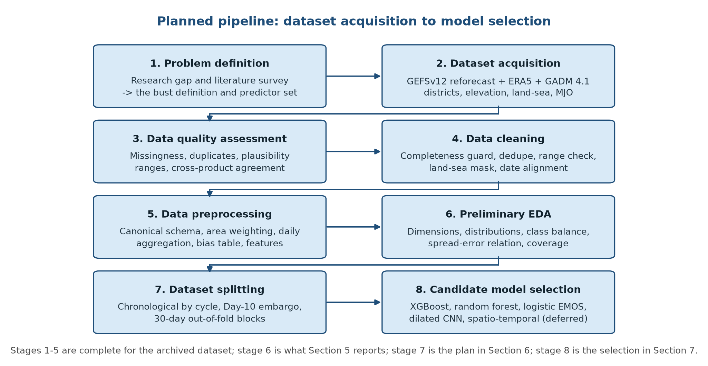

# Dataset Selection, Data Cleaning, Preprocessing, and Model Selection

*Explainable AI for District-Level Prediction of Medium-Range Weather Forecast Busts over India*

D N Harith (1DS24AI012) · Dhanush Thota (1DS24AI057) · AI&ML, 5th semester · Faculty guide: Dr. Kusumika Krori Dutta · 28-10-2026

*Generated by `build_report.py`; the PDF is the deliverable and this markdown is the same content in a reviewable form.*

## 1. Project Overview


### 1.1 Problem Statement

An operational centre already issues a medium-range forecast for every district of India, and statistical post-processing already removes the errors a model makes consistently. What survives that correction is the day-to-day failure: the forecast that is badly wrong because of the particular weather pattern of that day. Following Rodwell et al. [2], this project calls such a forecast a **bust**: an error that falls in the tail of that variable's own historical error distribution, above its 90th percentile, with the percentile computed on training data only and never on the rows being labelled.

Existing work diagnoses continental upper-air busts after the event [2], [3], verifies Indian rainfall and circulation at regional scale [6]-[9], or explains the weather quantity a model predicts rather than the model's own error [16]-[18]. What is missing is an operationally usable, calibrated and locally explained probability that a specific medium-range forecast will fail, for several surface variables at once, at district scale over India. The problem is hard for a reason the data makes visible: ensemble spread is informative about error but far from sufficient, measured here as a rank correlation of 0.20 for temperature and 0.84 for rainfall (Section 5).

This report addresses the **data** part of that study: which dataset is used, why it is appropriate, what is wrong with it, how it is cleaned and preprocessed, what the preliminary statistics show, how it will be split without leakage, and which candidate models the project will compare. It makes no claim to be a new weather forecast, and it reports no model performance.


### 1.2 Project Objectives

1. Build a leakage-free, district-level paired dataset in which a GEFSv12 ensemble forecast and its verifying ERA5 observation are compared on one spatial unit (666 GADM 4.1 districts), one time unit (the UTC day) and one canonical schema, for lead days 1-10 across 2000-2019.
2. Diagnose and treat the data-quality problems that actually occur in this dataset (missing forecast steps, duplicate truth products, misaligned date conventions, implausible ensemble members, sea read as saturated soil, observation-derived leakage) and record the measured effect of each treatment.
3. Define the bust label as the 90th percentile of a variable's own bias-corrected error, fitted on training cycles only, and carry the any-variable event label that the model must predict.
4. Engineer the predictors that hold the predictability signal at issue time: ensemble spread and member count, run-to-run jumpiness, time-lagged ensemble features, tendencies, season, district geography and the Madden-Julian Oscillation.
5. Specify a chronological split with a Day-10 embargo and 30-day out-of-fold blocks, and demonstrate that no observed day, threshold, bias table or calibrator is shared between training and evaluation.
6. Select candidate models (gradient-boosted trees, random forest, calibrated logistic regression, a dilated convolutional network and a spatio-temporal recurrent network) and justify each on the problem type, the dataset characteristics, the expected computational cost and the literature.


### 1.3 Proposed Approach

The project treats the problem as supervised tabular classification over a paired forecast-observation record, with a regression stage in front of it. For each variable, a gradient-boosted regressor estimates the absolute error that the ensemble mean is about to make, using only information available at issue time. Its out-of-fold predictions, together with spread, jumpiness and context features, form the design matrix of a binary classifier that outputs P(bust) per district, per variable, per lead day. Probabilities are mapped to observed frequencies by a Platt fit on validation data, and every prediction carries TreeSHAP attributions so a duty forecaster can see which inputs drove it [13], [14], [15].

Two model families are carried rather than one: the tabular model above, and a dilated convolutional network that reads the raw 0.25° fields and can see the synoptic pattern a district-mean row cannot express. Both are scored on identical held-out rows against a ladder of baselines (climatology, lead-day, spread, EMOS, IDR indestructible-rainfall and analog), because a bare ROC-AUC claims nothing without the answer to "against what?" [1], [10], [11]. The dataset, cleaning and preprocessing described in this report are what make that comparison honest.


## 2. Dataset Description


### 2.1 Dataset Information


**Table 1. Dataset information**


| Parameter | Description |
|---|---|
| Dataset name | Sanket India district weather-forecast bust dataset: NOAA GEFSv12 reforecast (forecast side) + ERA5 reanalysis (verifying truth) aggregated to 666 GADM 4.1 districts, 2000-2019 |
| Dataset source / URL | GEFSv12 reforecast, AWS Open Data bucket *noaa-gefs-retrospective*: https://registry.opendata.aws/noaa-gefs-reforecast/  |  ERA5: https://cds.climate.copernicus.eu/datasets (reanalysis-era5-single-levels)  |  Districts: https://gadm.org/  |  Elevation: https://api.open-elevation.com  |  MJO: https://psl.noaa.gov/mjo/ |
| Domain / application | Meteorology and operational forecasting: probabilistic prediction of forecast failure (bust) for surface weather variables, with per-prediction explanation |
| Total records / samples | 242.7 million district-member-lead forecast rows across 7,288 daily cycles (2000-2019); 2017 was measured end to end at 12,154,500 rows with every cycle exactly 33,300 rows. This report's measurements use the archived 2019 sample: 30,600 forecast rows (17 cycles x 36 stations x 5 members x 10 lead days) and 13,680 observation rows (380 days x 36 stations), giving 6,120 forecast-observation pairs |
| Number of features / attributes | 20 stored attributes per canonical row; 12 GEFSv12 fields (8 surface variables, 2 wind components, plus Z500/CAPE/CIN for the CNN); 24 engineered model inputs per regressor row (22 numeric, 2 categorical) plus one concurrent forecast column per variable; 6 district descriptors and 6 static grids |
| Target variable / class labels | Binary label *bust* per (district, variable, valid date, lead day): 1 if the bias-corrected absolute forecast error exceeds that variable's training-set 90th percentile, else 0. The continuous absolute error is carried alongside and is the regression target; the 8-variable *event* label is 1 if any variable busts |
| Data format | Sources: GRIB2 (reforecast), NetCDF and ZIP of NetCDF (ERA5), CSV/XLSX/JSON (IMD, MJO, status), GeoJSON (GADM). Store: hive-partitioned Apache Parquet plus SQLite lineage; figures and exports in CSV/PNG |
| Dataset licence | GEFSv12 reforecast and the GEFS feed: public domain (NOAA Open Data). ERA5: CC-BY 4.0 ("Generated using Copernicus Climate Change Service information"). GADM 4.1: free for academic and non-commercial use, redistribution requires GADM's permission. SRTM elevation: acknowledge CIAT. MJO OMI: NOAA open data. The project's own code and documents are MIT-licensed and carry none of these terms onward |

Licences are separated per source in *REUSE.toml* and *THIRD_PARTY_NOTICES.md*; a boundary geometry for a political map of India raises questions of its own, reviewed in *docs/boundary-geometry-licensing.md*.


### 2.2 Dataset Selection Justification

The dataset was selected against the criteria below, and each is answered with a property of the data rather than with a claim about it.

• **Relevance to the question.** The task is to predict the error of an already-issued forecast, so the dataset must contain both an ensemble forecast archive and an independent verifying truth for the same place and day. GEFSv12 reforecast and ERA5 provide exactly that pair for 2000-2019, with the same 0.25° grid and a documented daily convention, so the two sides can be reduced through one weight table instead of two approximations of geography.
• **Relevance to the region.** The study is about India: monsoon rainfall, Himalayan terrain, coastal and island districts. The dataset carries all 666 GADM 4.1 districts, including the districts with no 0.25° grid centre inside them (Kolkata, Hyderabad, the Puducherry enclaves, Lakshadweep), which a nearest-point sample would silently drop.
• **Size.** A bust is by construction a 10% tail event, and the event label fires on 38.6% of paired days only because several variables are combined; rare failures are learnable only if the archive is long. Twenty years of daily cycles at 666 districts gives roughly 4.9 million district-days before any lead or member expansion, against the 106 cases of the closest published study [1].
• **Quality and traceability.** Every value carries the file, message and API that produced it; the forecast side records the GRIB2 object path and message number per variable, and the observation side records the product and endpoint. Nothing is synthetic, simulated, interpolated or placeholder: where a number could not be fetched, there is no row.
• **Suitability of the predictors.** The archive carries the fields that hold the predictability signal at issue time: five ensemble members for spread, consecutive initialisations for run-to-run jumpiness and a time-lagged pool, twelve variables for concurrent conditions, and a daily MJO index as a large-scale covariate.
• **Comparability with the literature.** The dataset and the label are defined so that the project's results can be compared with the studies reviewed in its literature survey: percentile-based skill classes [1], ensemble-spread baselines [1], [10], EMOS post-processing [10], [11] and verified Indian rainfall skill [6]-[9].


### 2.3 Dataset Characteristics

The dataset has four linked, all-numeric parts: a **forecast archive** (one 00 UTC cycle a day, five members, lead days 1-10), a **verifying observation archive** (ERA5 on the same grid and the same UTC-day convention), a **geography layer** (666 districts in 36 states, 10,373 district-cell weights over 4,902 cells, every district's weights summing to exactly 1.0), and **covariates** (4,902 cell elevations, an ERA5 land-sea mask, and 12,959 daily MJO index rows spanning 1991-01-01 to 2026-06-24).


**Table 2. Variables carried, their role and their label status**


| Canonical variable | Unit | Forecast field | Leads held | Role |
|---|---|---|---|---|
| temperature_c | °C | tmp_2m (t2m) | Day 1-10 | Label + input |
| humidity_pct | %RH | spfh_2m (sh2), converted after the district mean | Day 1-10 | Label + input |
| rainfall_mm | mm/day | apcp_sfc, accumulated over the model day | Day 1-10 | Label + input |
| pressure_hpa | hPa | pres_msl (msl) | Day 1-10 | Label + input |
| atmospheric_moisture_kgm2 | kg/m² | pwat_eatm (pwat) | Day 1-10 | Label + input |
| wind_speed_ms | m/s | ugrd_hgt / vgrd_hgt (u10, v10) | Day 1-5 only | Label + input |
| wind_direction_deg | degrees from | ugrd_hgt / vgrd_hgt | Day 1-5 only | Input only, never a label |
| soil_moisture_pct | % volumetric | soilw_bgrnd, top layer | Day 1-3 only | Label, masked over sea |
| Z500, CAPE, CIN | m, J/kg, J/kg | gh500, cape_sfc, cin_sfc | Day 1-10 | CNN input channels only |

Wind direction is an input and never a label: a daily resultant direction is mostly noise when the wind is light, and 86.5% of its apparent busts under plain angle arithmetic disappear once the error is measured the short way round the circle.

**Data types and structure.** Every stored attribute is numeric, categorical or a timestamp; there is no text, image or free-form field in the training path. The rows are not independent samples: consecutive days at one district are strongly autocorrelated, neighbouring districts share 0.25° cells through the weight table, and the five members of one cycle are perturbations of a single analysis rather than five observations of the atmosphere. That structure is the reason the split in Section 6 is chronological and block-based.

**Class distribution.** Per variable the bust label is 10% by construction (it is a 90th-percentile cut), so a per-variable class balance tells us nothing; what matters is the event label. Any-variable busts occur on 38.6% of the 6,120 paired days in the archived sample, rising from 32.8% at Day 1 to 42.8% at Day 10, and the published base rate on held-out data is 43-49%. The classifier is therefore not re-weighted for rarity: a model that assumed a 10% base rate would be mis-specified.

**Known limitations, stated with their numbers.** The truth is a reanalysis, not a gauge network: ERA5 and MERRA-2 disagree per day by 24-43% of the bust threshold depending on the variable (rainfall 24%, humidity 36%, wind 38%, temperature 43%, over 21,492 paired city-days), and that disagreement is a floor under every label. Only five of the thirty-one operational members exist in the archive, so spread is a noisy estimate. Two variables stop early (10 m wind at Day 5, soil moisture at Day 3) and are not scored beyond those leads. Rainfall truth is ERA5 rather than IMD gauge data in the current run. And the bust is defined on surface-variable error rather than on the synoptic 500 hPa criterion of Rodwell et al. [2], deliberately, because surface error is what reaches agriculture and disaster response.


## 3. Data Cleaning


### 3.1 Data Quality Assessment

This dataset is fetched from other people's archives rather than authored by the team, so its cleaning is not about repairing typing errors. It is about the places where two individually correct products will still disagree or mislead. Each candidate issue below was checked against the data, and a treatment was chosen only where a check found something. The measurements in this section are computed by the build script from the files in *backend/data/*.


**Table 3. Data quality assessment: what was checked and what was found**


| Quality issue | Check performed | Finding (measured) |
|---|---|---|
| Missing values | Null count per column on both products, and missingness by lead day | 0 nulls in the 13,680-row observation file. On the forecast side, 21.2% of numeric cells are null, and all of them are structural: 15,300 rows for 10 m wind and wind direction (50.0%, Day 1-5 only) and 21,420 rows for soil moisture (70.0%, Day 1-3 only). No variable with a full archive has a null. See Figure 1 |
| Duplicate records | Duplicate canonical keys, and duplicate (station, date) pairs in the truth | 0 duplicate forecast keys and 0 duplicate observation keys in the archived sample. Duplicates do occur in the live store when a source is re-ingested: IMD rainfall batches ingested after ERA5 won the dedupe and replaced 2016-2019 rainfall truth (found 2026-09-25) |
| Inconsistent entries | Unit, accumulation-window and date-convention checks across sources | Inputs arrive as GRIB2, NetCDF, zipped NetCDF, CSV, XLSX and JSON. ERA5 stamps an accumulation with the end of its hour; humidity is specific humidity on the forecast side and relative humidity on the observation side; wind arrives as two components; IMD's gauge day runs 0830-0830 IST, so IMD date D is model day D-1 (settled from data, not documentation: rainfall on IMD date D correlates best with ERA5 summed to UTC day D-1 for 8 of 8 test districts, mean Spearman 0.698 against 0.556 at lag 0) |
| Invalid values / outliers | Per-variable plausible range on every member, every variable, every cycle | Real extremes stay in range and must stay: Leh reaches &minus;30.55 °C on 2019-01-09 Day 6, Bhopal 294.7 mm/day of rainfall on 2019-07-17 Day 9, column water vapour 78.0 kg/m². The archive has also produced two genuinely corrupt member-days in twenty years: p03 of 2004-03-05 with Day-2 temperature between &minus;23,380,072 and +21,808,336 °C in all 666 districts (other members &minus;18.5 to +32.4 °C), and p01 of 2019-02-09 with Day-1 column water vapour of 12,500-12,546 kg/m² (others 0.7-55.3). One such member put that day's temperature RMSE at 34,612 °C |
| Incorrect labels (sea read as land) | Soil moisture compared between products for every district, and a land fraction per district from both masks | 765 forecast rows (2.5% of the file) sit at or above 99.5% volumetric soil, all of them at Daman, Kavaratti, Port Blair. GEFS writes the sea as saturated soil while ERA5 writes it as 0: Daman and Kavaratti forecast 99.99-100% against a truth of 0.0%, and Port Blair 100% against 18.6%. Paired without a mask, four districts busted on 100% of their soil-moisture rows against 0.9% elsewhere |
| Incorrect labels (standing bias) | Signed error per district, variable and lead, fitted leave-one-cycle-out | 64% of squared error for temperature and humidity, and 90% for soil moisture, is a fixed per-district offset rather than a daily failure. The humidity offset ranges from -23.2 %RH at New Delhi to +12.3 %RH at Leh (mean -9.0 %RH) across the 36 sample stations. Left in, a 'bust' means 'this district is always off' |
| Incorrect labels (leakage) | Audit of every model input for observation-derived content; correlation of input availability with issue time | One input, *forecast_error_lag*, read the realised error of the previous lead of the same forecast, which no live cycle can know; it is removed and a test now refuses observation-derived columns. The MJO block was dropped for the same class of reason: NOAA PSL does not publish OMI in real time, so every live cycle had it as NaN while every training row had a value |
| Incomplete cycles | Structural row-count check per cycle before the daily reduction | 7,288 of the 7,305 archive dates are present (99.77%). NOAA drops forecast steps mid-pull, and a short rainfall sum silently halves the quantity that drives most busts, so an incomplete cycle is refused rather than published short. Measured on 2017: 365 cycles, 12,154,500 rows, zero refusals, every cycle exactly 33,300 rows |
| Skewed and zero-inflated labels | Distribution of each variable's error and of the observation itself | 44.8% of observation days are dry (rainfall at or below 0.01 mm), while rainfall error spans a median of 1.53 mm/day and a maximum of 171 mm/day. A fixed millimetre threshold would label almost nothing in a dry district and almost everything in the monsoon |


*Figure 1. Missingness in the archived 2019 reforecast sample (30,600 rows). (a) the non-null share of each variable by lead day: the two white blocks are the archive's own lead limits, identical for every cycle and member, not a data loss. (b) null rows per column, in red, and in amber the rows where GEFS saturates soil moisture at 99.5% or more at Daman, Kavaratti and Port Blair - a value that is present but is not a measurement of soil.*

### 3.2 Data Cleaning Plan

The cleaning plan follows the template's five issue classes, with a treatment for each and the reason the treatment was chosen over the obvious alternative. Where an issue is not present, the table says so and cites the check that shows it.


**Table 4. Cleaning plan: technique applied or proposed, and the reason**


| Data quality issue | Proposed / applied technique | Reason |
|---|---|---|
| Missing values | No imputation anywhere. A structural absence is represented as the absence of a row; a per-cycle completeness guard refuses a cycle that is short of its 33,300 rows, with an S3 byte-range fallback that refills missing GRIB2 messages before the daily reduction. Soil moisture is masked, not filled, for districts more than 5% sea in either product | A short rainfall sum is about half the real accumulation, and a fabricated member enters the ensemble spread as evidence. Masking is honest where imputation is not: an island district has no soil-moisture value to compare |
| Duplicate records | Dedupe on (region, valid date, variable, value type, init date, lead, member, source column), newest non-provisional row winning; quarantined and retired batches refused before any frame is built; a cached year is rebuilt when its batch signature changes | A duplicate here is not a repeated row, it is a different truth product: it changes the label silently and inflates any score computed on it |
| Inconsistent values | Format-agnostic parsers into one canonical schema with confidence-scored column matching; accumulation grouped by valid time minus one hour; relative humidity derived from specific humidity, temperature and pressure after the district mean on both sides; speed and direction derived from u and v; the CDS ZIP unzipped and both NetCDF files read; IMD dates moved back one day and the merge refused unless its rainfall correlates best with ERA5 at lag 0 | One schema and one set of units is what makes a forecast row and a truth row comparable at all; deriving RH after the mean on both sides keeps a bounded quantity from being averaged as a ratio |
| Outliers / invalid entries | Range check against a per-variable plausible range at the head of the one frame-building path that training, scoring, live and Replay all share; a corrupt member is dropped and the ensemble is the members that remain. Real extremes are kept | The check must catch a 21,808,336 °C member without deleting the &minus;30.55 °C Himalayan day or the 294.7 mm/day rainfall day, because the label lives in exactly that tail |
| Incorrect labels | Busts defined on bias-corrected error: the training-period mean error per (district, variable, lead, month) is removed first, backing off to the district's month across leads and then to its year when a cell holds fewer than 30 events; a key thin at every level is not compared at all. Soil moisture is dropped on both sides for districts above the 5% sea threshold, and the exclusion list is required to exist rather than defaulted | Otherwise a bust means 'this district is always off', which NCMRWF's own post-processing already removes; the failure that remains is the one worth predicting. The humidity threshold for November 2017 falls from 27.6 to 10.4 %RH after the correction |


### 3.3 Cleaning Evidence

Two properties of this dataset make the usual before-and-after summary misleading: the cleaning is mostly verification, and several treatments change the label without changing a single value. The table therefore reports the quantity each treatment moved, measured, rather than a count of edited cells.


**Table 5. Before-and-after measurements of the cleaning steps**


| Quantity | Before the treatment | After the treatment |
|---|---|---|
| 2004-03-05 Day-2 temperature RMSE, with the corrupt p03 member in | 34,612 °C | Within the plausible range: exactly 666 rows dropped on each affected cycle, none on a clean one |
| Soil moisture for the three sea-covered sample stations | Daman 99.99%, Kavaratti 100.0%, Port Blair 100.0% volumetric against an ERA5 truth of 0.0%, 0.0% and 18.6% - a guaranteed bust on every row | Not compared at all: 18 districts exceed the 5% sea threshold in GEFS or ERA5 and are excluded on both sides |
| Humidity bust threshold, Nov 2017, 666 districts | 27.6 %RH on raw error (a dry-biased forecast made an ordinary day look like a failure) | 10.4 %RH after per-district, per-lead bias correction |
| Wind-direction error p90, real CI sample | 191.0° under plain angle arithmetic (a northerly is a bust by construction; 86.5% of direction busts were this artefact) | 115.1° with the error taken the short way round the circle; ensemble spread p90 falls from 118.0° to 55.0° |
| Event bust rate by lead, leaving out each district's own bias | 0.31 at Day 1 rising to 0.50 at Day 10 only after the offset is removed; correlation of lead with bust about 0.02 before | 0.25 at Day 1 to 0.50 at Day 10 with the bias removed leave-one-cycle-out, and rainfall growing with lead throughout |
| Rainfall truth for 2016-2019 in the live run | One-day-late IMD-merged rainfall, differing from ERA5 in 72.5% of 2018 rows and 79.8% of 2019 rows | ERA5 CDS batches; the four IMD batches quarantined, and any frame build that finds them now stops instead of choosing |

The integrity checks that produce the numbers in Tables 3 and 5 are a few lines of code and run at the head of every frame build, so a regression in any of them fails the build rather than the report:

```python
# backend/app/ml/train_pipeline.py - the checks a frame must pass before any model sees it
keys = ["region_id", "init_date", "valid_date", "lead_time_days", "ensemble_member_id"]
assert not paired.duplicated(subset=keys).any(), "duplicate canonical key"
assert paired["value"].notna().all(), "null value in the canonical store"
model_rows = paired[paired["value_type"] == "forecast"]
short = model_rows.groupby("init_date").size()
assert (short == 33_300).all(), f"short cycle(s): {(short != 33_300).sum()}"

# a corrupt ensemble member is dropped, never averaged into the spread
in_range = fc_mean.between(PLAUSIBLE[variable][0], PLAUSIBLE[variable][1])
member_ok = in_range | fc_mean.isna()
value = value.where(member_ok)                       # NaN, not zero
```
*Listing 1. The integrity checks and the plausible-range filter, as they run in training, scoring and the live cycle.*


## 4. Data Preprocessing


### 4.1 Preprocessing Workflow

Preprocessing runs in one direction and in one place. Both products pass through the same parsers, the same weight table, the same daily aggregation and the same range check, because the moment the two sides are treated differently the comparison they support is no longer a comparison. The sequence is:

1. **Parse** each source format into one canonical schema of 20 columns, matching columns by name with a recorded confidence score rather than by position.
2. **Resolve geography**: every value becomes an area-weighted mean over the 0.25° cells a district polygon overlaps, using a single weight table read at 10,373 district-cell pairs, each district's weights summing to exactly 1.0 (median 14 cells per district, 1-108).
3. **Aggregate to the UTC day**, grouping accumulations by valid time minus one hour and reducing 3-hourly fields to daily ones.
4. **Apply the plausible range** per variable and drop a member that fails it.
5. **Dedupe** on the canonical key with the newest non-provisional row winning.
6. **Derive the paired frame**: ensemble mean and spread per (district, variable, initialisation, valid date, lead), joined to the observed mean for the same key.
7. **Fit the bias table** per (district, variable, lead, month) on training cycles only, with the backoff described in Section 3.2, and subtract it from every member.
8. **Define the label**: absolute error above the variable's training-set 90th percentile, plus the 8-variable event label.
9. **Engineer features**: ensemble spread and member count, run-to-run jumps, the time-lagged ensemble pool, tendencies, season, district descriptors.
10. **Split and embargo**: chronological by cycle, ten days either side of every boundary, 30-day out-of-fold blocks inside training.
11. **Materialise** the design matrix for the tabular models and the multi-channel gridded tensors for the CNN, with a mask channel per input channel.


*Figure 2. The preprocessing chain. Blue stages are applied identically to the forecast and the observation side; green stages are fitted on training cycles only and then applied unchanged to validation, test and live data. The order is not cosmetic: the range check precedes the ensemble reduction so a corrupt member cannot reach the spread, and the bias table precedes the threshold so the label describes corrected error.*

### 4.2 Preprocessing Techniques


**Table 6. Preprocessing techniques, purpose and configuration**


| Technique | Purpose | Configuration / method |
|---|---|---|
| Missing-value handling | Keep a structural gap distinguishable from a measurement, and stop a partial cycle being read as a real one | No imputation. Absent row for a structural gap; per-cycle completeness guard (33,300 rows per cycle) with an S3 byte-range refill; land-sea mask exclusion for soil moisture above 5% sea; 1/0 mask channel per CNN input channel |
| Categorical encoding | Let a tree model use district identity without giving it 666 levels to memorise | *state_id* (36 levels) as a native XGBoost categorical, plus the derived descriptors centroid latitude/longitude, area, distance to the country's edge and mean elevation; *season* as DJF/MAM/JJAS/ON; *month* as an integer. The 666-level region identifier is deliberately not a feature |
| Feature scaling / normalisation | Give the convolutional channel normaliser a defined scale; leave the trees alone | None for the stored data or for XGBoost, which is invariant to a monotone rescaling; per-channel mean and standard deviation for the CNN, fitted on training cycles only, because a normaliser fitted on the whole archive leaks the test period's climate into training |
| Feature selection / extraction | Carry the predictability signal and refuse anything that is not available at issue time | 24 engineered inputs per regressor row (spread, member count, four jumpiness features, four time-lagged-pool features, two tendencies, historical bust frequency, six district descriptors, bias correction, lead, month, season, forecast value) plus one concurrent forecast column per variable; observation-derived columns are refused by a contract check |
| Imbalance and tail handling | Keep the tail available to the model without fabricating rows | No resampling and no *scale_pos_weight*: the percentile definition makes each variable's label exactly 10%, the event label is 38.6-49%, and re-weighting pushed every probability up and broke calibration |
| Probability calibration | Make a predicted probability mean what it says | Platt scaling (a one-dimensional logistic fit) on the validation split, with a non-positive slope refused; an uncalibrated classifier's lowest reliability bin predicted 0.158 against about 0.07 observed |
| Image resizing / enhancement | Not applicable | The CNN reads the native 0.25° grid; there is no downsampling anywhere. Dilations 1, 2, 4, 8 give a 31-cell (about 850 km) receptive field at grid resolution, which keeps the district weight table valid for pooling |
| Text cleaning / tokenisation | Not applicable | There is no text, image or free-form field in the training path |
| Circular and derived quantities | Stop an angle or a ratio being treated as a plain number | Wind-direction error taken the short way round the circle; relative humidity derived from specific humidity, temperature and pressure after the district mean on both sides; wind speed and direction derived from u and v |


### 4.3 Preprocessing Justification

**Why one weight table and not two samples.** Ten districts contain no 0.25° grid centre at all, so a nearest-point sample cannot represent them, and a district sampled differently on the forecast side than on the truth side would carry a spatial error that looks like a forecast error. One area-overlap table, used by both sides, makes the pair a comparison of the same polygon. Validated against the 35 city points it replaces: correlation 0.9896, median absolute difference 0.31 °C.

**Why no imputation.** Every missing cell in this dataset is a structural absence: five members, ten leads, and fields that the archive itself stops serving at Day 3 or Day 5. Imputing a missing rainfall accumulation would fabricate the quantity that drives most busts, and imputing a missing member would enter the ensemble spread as though it were evidence of uncertainty. A model told where its inputs are real (the mask channel, or the absent row) learns the structure; a model fed a plausible average learns a fiction.

**Why bias correction comes before the label.** If a bust is defined on raw error, the label mostly records which districts the model is persistently off in, and 64% of squared error for temperature and humidity (90% for soil moisture) is exactly that. The measured humidity offsets in Table 3 span -23.2 to +12.3 %RH across 36 stations, which is a standing offset, not a daily failure. Subtracting a training-only monthly mean first makes the label describe the failure that survives correction, which is the failure an operational centre cannot already remove.

**Why no scaling and no resampling.** A gradient-boosted tree splits on order, so a monotone rescaling changes nothing it reads and would only add a version to every stored file; the CNN, which does need a scale, gets one fitted on training cycles only. Resampling the 44.8% dry days would repeat near-identical rows rather than add information, and would break the correspondence between predicted probability and observed frequency that the Platt fit exists to establish.

**Why the descriptors replace the district identifier.** A 666-level categorical can only learn a district it saw labelled in training, and roughly 34 regions ever carry a label in the CI sample. Latitude, longitude, area, distance to the edge of the landmass and mean elevation are defined for every district, including one the model has never seen, and they are the quantities that actually drive error: Leh's mean elevation of 4,943 m runs about ten times the typical district's pressure error.


### 4.4 Preprocessing Evidence

The pairing rule is one function, used by training, scoring, live cycles and Replay alike, so a cycle is verified later against exactly what it would have been scored against:

```python
# one pairing rule for both sides of the bust label (app/features/engineering.py)
def observed_means(df):
    """One observation per (region, valid date, variable): the mean of the rows held
    for it, and "provisional" if any of them is."""
    ob = df[df["value_type"] == "observed"]
    return (ob.groupby(["region_id", "valid_date", "variable"], observed=True)
              .agg(obs=("value", "mean"),
                   provisional=("verification_status", lambda s: (s == "provisional").any()))
              .reset_index())

# ensemble mean and spread at the event grain, then the pair
fc = (g.groupby(EVENT_KEYS + ["ensemble_member_id"], observed=True)["value"].mean()
        .groupby(EVENT_KEYS).agg(fc_mean="mean", fc_std="std", members="size"))
paired = fc.merge(ob, on=["region_id", "valid_date", "variable"], how="inner")
paired["error"] = (paired.fc_mean - paired.obs).abs()
```
*Listing 2. The single pairing rule: the ensemble is reduced to a mean and a spread per event, then joined to the observed mean for the same district, variable and UTC day.*

```python
# chronological split with a Day-10 embargo (app/ml/train_pipeline.py)
SPLIT_EMBARGO_DAYS = 10   # a cycle at d is verified against days d .. d+9

def _embargo_before(cycles, boundary):
    cut = pd.Timestamp(boundary) - pd.Timedelta(days=SPLIT_EMBARGO_DAYS)
    return [c for c in cycles if pd.Timestamp(c) <= cut]

train, val, test = cycles[:a], cycles[a:b], cycles[b:]
val = _embargo_before(val, test[0])          # no shared observed day
train = _embargo_before(train, val[0])       # ... at either boundary, ever
```
*Listing 3. The embargo that keeps the same observed day off both sides of every split and out-of-fold block boundary.*


## 5. Preliminary Exploratory Data Analysis (EDA)

The analysis below is computed at build time from the archived 2019 sample and the geography layer, so every number and figure in this section is a measurement of the files in the repository rather than a quotation. The sample is deliberately seasonally spread: fortnightly cycles through the monsoon and monthly otherwise, so 32% of its observation days fall in June-September.


### 5.1 Dimensions and summary statistics


**Table 7. Dimensions of the analysed files**


| File | Rows | Columns | Grain | Purpose |
|---|---|---|---|---|
| gefs_reforecast_india_2019.parquet | 30,600 | 36 | 17 cycles x 36 stations x 5 members x 10 lead days | Forecast side of the pair, and the source of spread |
| era5_observations_india_2019.parquet | 13,680 | 16 | 380 days x 36 stations | Verifying truth for the bust label |
| district_descriptors.parquet | 666 | 7 | one row per district | Static geography features |
| district_grid_weights.parquet | 10,373 | 4 | district-cell weight | The one spatial reduction used by both sides |
| mjo_omi_index.parquet | 12,959 | 5 | one row per day | Large-scale covariate (dropped from new runs while the tail is stale) |
| grid_elevation_m.parquet | 4,902 | 4 | one row per cell | Elevation descriptor and CNN terrain channel |
| era5_land_sea_mask.parquet | 4,902 | 3 | one row per cell | Sea masking (95.7% of the cells the weight table uses are land) |

After pairing, 6,120 forecast-observation rows remain, 612 for each of the ten lead days and 3,060 for wind speed, whose archive stops at Day 5. The join is lossless: every archived forecast row has a truth for the same station and UTC day.


**Table 8. Summary statistics of the paired features (forecast ensemble mean and ERA5 observation, archived 2019 sample)**


| Variable (unit) | Side | Min | 25% | Median | 75% | Max | Mean | Std |
|---|---|---|---|---|---|---|---|---|
| temperature_c (°C) | forecast | -29.33 | 21.44 | 25.95 | 28.66 | 42.50 | 24.37 | 7.92 |
|  | observed | -12.86 | 20.61 | 25.74 | 28.06 | 38.79 | 23.73 | 6.99 |
| humidity_pct (%RH) | forecast | 8.21 | 54.00 | 69.77 | 80.49 | 99.21 | 65.62 | 19.73 |
|  | observed | 12.17 | 67.78 | 79.50 | 86.83 | 99.08 | 74.66 | 16.47 |
| rainfall_mm (mm/day) | forecast | 0.00 | 0.04 | 2.28 | 9.42 | 98.18 | 6.61 | 10.02 |
|  | observed | 0.00 | 0.00 | 1.20 | 7.00 | 190.50 | 6.36 | 13.49 |
| pressure_hpa (hPa) | forecast | 990.41 | 1002.98 | 1008.48 | 1013.05 | 1054.20 | 1008.09 | 6.78 |
|  | observed | 989.87 | 1003.91 | 1009.01 | 1013.33 | 1040.62 | 1008.72 | 6.24 |
| atmos. moisture (kg/m²) | forecast | 0.52 | 21.84 | 40.23 | 55.50 | 73.60 | 38.84 | 18.74 |
|  | observed | 0.75 | 23.16 | 42.08 | 56.90 | 79.24 | 40.14 | 18.94 |
| wind_speed_ms (m/s) | forecast | 0.15 | 1.15 | 2.24 | 3.94 | 14.92 | 2.82 | 2.20 |
|  | observed | 0.02 | 0.77 | 1.76 | 3.02 | 12.68 | 2.14 | 1.72 |

Wind is paired on 3,060 of the 6,120 rows, because the archive holds it only to Day 5. The humidity comparison already shows the dry bias that motivates the bias table: a median forecast of 69.8 %RH against an observed median of 76.2 %RH.


### 5.2 Data types and feature distributions

Every measurement is a floating-point number, every identifier is a string read as a categorical, and every temporal key is a date. Two shapes are worth noting before any model sees them. Rainfall is zero-inflated and heavy tailed: nearly half of the observation days are dry, the forecast median is 0.92 mm/day against an observed median of 0.20 mm/day, and the largest daily accumulation in the sample is 294.7 mm/day. Humidity is left-skewed and bounded at 100 %RH, and the forecast distribution sits visibly to the left of the observation - the standing dry bias, not a scatter.


*Figure 3. Feature distributions of the paired frame, forecast ensemble mean against ERA5 observation, for the six label variables. The forecast distributions are narrower than the observed ones for temperature and water vapour - an ensemble mean is a smoothed field - and shifted left for humidity. Rainfall is zero-inflated on both sides. Panels are clipped at the 99.5th percentile so the bulk remains visible; no rows are removed.*

### 5.3 Target-variable and class distribution

The continuous target is the absolute error of the pair; the label is its tail. Table 9 gives both, with the 90th percentile that becomes the bust threshold when it is fitted on training cycles. Table 10 gives the resulting class distribution at the event grain.


**Table 9. Error statistics of the paired sample and the bust threshold it implies (in-sample percentile, for illustration)**


| Variable | Pairs | Bias | MAE | Median | p90 | p99 | Max | r(fc, obs) |
|---|---|---|---|---|---|---|---|---|
| temperature_c (°C) | 6,120 | +0.64 | 1.81 | 1.25 | 4.16 | 8.54 | 17.3 | 0.951 |
| humidity_pct (%RH) | 6,120 | -9.04 | 11.11 | 9.11 | 23.57 | 37.57 | 49.3 | 0.837 |
| rainfall_mm (mm/day) | 6,120 | +0.25 | 5.30 | 1.53 | 14.38 | 48.14 | 170.8 | 0.544 |
| pressure_hpa (hPa) | 6,120 | -0.62 | 1.31 | 0.88 | 2.98 | 6.37 | 19.7 | 0.964 |
| atmospheric_moisture_kgm2 (kg/m²) | 6,120 | -1.30 | 3.20 | 2.33 | 7.00 | 14.27 | 35.0 | 0.974 |
| wind_speed_ms (m/s) | 3,060 | +0.71 | 0.96 | 0.66 | 2.19 | 4.77 | 10.4 | 0.844 |

Units are each variable's own. The p90 column is the threshold a bust is cut at; in this illustration it is a quantile of the same rows it labels, which is why each variable then busts on exactly 10% of the sample. In production the threshold, the bias table and the calibrator are fitted on training cycles only.


![Figure 4. Distribution of the absolute forecast error per variable, with the 90th-percentile threshold as a dashed line. Every distribution is right-skewed, which is what makes a percentile definition necessary rather than convenient: the temperature threshold is 4.16 °C against a median of 1.25, and the rainfall threshold 14.4 mm/day against a median of 1.5. The same millimetre figure means something entirely different in a desert and in Kerala, which is why each variable carries its own threshold, fitted on the training cycles of every district, rather than the project using one number for all of them.](assets/fig4_target_distributions.png)

*Figure 4. Distribution of the absolute forecast error per variable, with the 90th-percentile threshold as a dashed line. Every distribution is right-skewed, which is what makes a percentile definition necessary rather than convenient: the temperature threshold is 4.16 °C against a median of 1.25, and the rainfall threshold 14.4 mm/day against a median of 1.5. The same millimetre figure means something entirely different in a desert and in Kerala, which is why each variable carries its own threshold, fitted on the training cycles of every district, rather than the project using one number for all of them.*

**Table 10. Class distribution: per-variable bust share and the any-variable event label**


| Label | Definition | Positive share | Rows |
|---|---|---|---|
| bust[temperature_c] | error above the variable's p90 | 10.0% (by construction) | 6,120 |
| bust[rainfall_mm] | error above the variable's p90 | 10.0% (by construction) | 6,120 |
| bust (each of the six variables) | error above the variable's p90 | 10.0% each | 6,120 |
| **event** (any variable busts) | OR across the six label variables paired in this sample (seven in the store, which also carries soil moisture) | **38.6%** | 6,120 |
| event, Day 1 / Day 5 / Day 10 | OR across the variables available at that lead | 32.8% / 42.3% / 42.8% | 612 each |
| event, monsoon (JJAS) / other months | OR across the variables, split by month | 48.6% / 28.5% | 1,964 / 4,155 |
| dry observation days (rainfall at or below 0.01 mm) | zero-inflation of the rainfall truth | 44.8% | 6,120 |

The event label is what the classifier predicts and it is not a 10% problem: with six variables each busting 10% of the time, the union would be 1 - 0.9^6 = 46.9% if the variables were independent, and the measured rate is 38.6% because the variables are correlated and fewer are available at longer leads. The published held-out base rate on the full store is 43-49%.


*Figure 5. Class distribution. (a) the event bust rate rises with lead day, from 32.8% at Day 1 to 42.8% at Day 10, as a forecast failure should; (b) it is not flat across the year, so month and season are real features and not decoration; (c) the measured rate tracks the number of variables available at each lead rather than the independence bound of 1 - 0.9^k, which is the quantitative reason the classifier is not re-weighted for rarity.*

### 5.4 Feature distributions against the target

Two relations determine the model choice in Section 7. Error grows with lead day, as a forecast failure should, and the growth is steepest for rainfall, which rises from 4.59 to 6.59 mm/day between Day 1 and Day 8 in this sample, while temperature error moves from 1.70 to 1.83 °C over the same leads - the signature of a steady per-district bias rather than a forecast coming apart. And ensemble spread is informative about error but not sufficient: its rank correlation with the absolute error is 0.84 for rainfall, 0.40 for wind speed, 0.32 for pressure and 0.20 for temperature.


![Figure 6. (a) mean absolute error by lead day for four variables, in each variable's own units: rainfall error climbs from Day 1 to Day 8 while temperature error is nearly flat, which is the difference between a forecast coming apart and a district that is simply off. (b) mean absolute error by ensemble-spread decile: a monotone relation for both variables, and a much stronger one for rainfall than for temperature. Spread alone would rank days usefully but would miss the bias-driven half of the problem, which is why the models in Section 7 take spread as one feature among several.](assets/fig6_error_by_lead_and_spread.png)

*Figure 6. (a) mean absolute error by lead day for four variables, in each variable's own units: rainfall error climbs from Day 1 to Day 8 while temperature error is nearly flat, which is the difference between a forecast coming apart and a district that is simply off. (b) mean absolute error by ensemble-spread decile: a monotone relation for both variables, and a much stronger one for rainfall than for temperature. Spread alone would rank days usefully but would miss the bias-driven half of the problem, which is why the models in Section 7 take spread as one feature among several.*
A third relation matters for the split: "monsoon" is not a cosmetic label. Rainfall MAE is 8.25 mm/day in JJAS against 2.29 elsewhere, and pressure MAE 1.62 hPa against 0.98. A random row split would put the same monsoon day on both sides of the evaluation and report a skill that no held-out season supports.


### 5.5 Missing-value and duplicate summary


**Table 11. Missingness and duplication, summarised**


| Check | Forecast sample | Observation sample |
|---|---|---|
| Rows | 30,600 | 13,680 |
| Null cells | 52,020 (21.2% of numeric cells), all structural | 0 |
| Columns with any null | 3 of 36 (wind speed, wind direction, soil moisture) | 0 of 16 |
| Duplicate rows | 0 | 0 |
| Duplicate canonical keys | 0 | 0 |
| Values outside the plausible range | 0 in this sample; 2 corrupt member-days in the full 2000-2019 archive | 0 |
| Pairs lost in the join | 0 of 6,120 reduced station-day-lead forecasts have no truth | - |


### Key Observations

1. The join is lossless and the missingness is structural, not accidental: 6,120 of 6,120 reduced forecast rows found a truth, and every null in the forecast sample is the archive's own lead limit (wind at Day 5, soil moisture at Day 3). No imputation is needed or justified.
2. Values that are present can still be wrong. The soil-moisture field reaches 100% volumetric at three coastal stations where the truth is 0-18.6%, and this is a label error rather than a data-entry error: paired without a mask it would have manufactured a bust on every row for four districts.
3. The label is heavy tailed and zero-inflated in rainfall (44.8% dry days, a maximum error of 171 mm/day against a median of 1.53), so a percentile definition per variable is necessary rather than convenient, and any fixed threshold would be wrong somewhere.
4. The event label fires on 38.6% of paired days and rises with lead to 42.8%, so the problem is not a rare-class problem and the classifier must not be re-weighted for imbalance.
5. Ensemble spread predicts error monotonically but weakly for temperature and pressure (rank correlation 0.20 and 0.32) and strongly for rainfall (0.84); a spread-only model is a baseline to beat, not a solution.
6. Season dominates the error scale (rainfall MAE is 3.6 times higher in JJAS), so the split must be chronological and the features must carry month, season and geography; a random split would leak the season into the test set.


## 6. Dataset Splitting Plan


**Table 12. Planned data split**


| Dataset subset | Proposed percentage | Planned purpose |
|---|---|---|
| Training | 70% of the pre-2017 cycles | About 4,330 of the 6,200 daily cycles of 2000-2016, minus the ten-day embargo: the bias table, the bust thresholds, the historical bust frequency, the error regressors and the bust classifier |
| Validation | 15% of the pre-2017 cycles | About 930 cycles from the tail of 2000-2016, embargoed from the test year: early stopping, hyper-parameter choice, the Platt calibrator and threshold review. Validation scores are optimistic by construction and are never quoted as test results |
| Testing | 15% of cycles | All 365 cycles of 2017, held out entire: every metric the project publishes, the promotion gate and the baseline ladder. 2018 and 2019 sit in the archive unused and are the next evaluation |
| Embargo | 10 days either side of every boundary | No observed day appears on both sides of a split or of an out-of-fold block; out-of-fold blocks are 30-day spans of forecast cycles |

The template's 70/15/15 is the plan and is kept, applied to the cycles before the test year. Because the test set is a whole calendar year rather than a random 15% of rows, the realised test share is 5% (one year of twenty); it becomes 15% when 2017, 2018 and 2019 are all scored in the next phase. The model now served was trained on all of 2000-2016 with early stopping inside that span (6,193 cycles); the next run applies the split above.


*Figure 7. The chronological split. Training and validation are both inside 2000-2016 and separated by a ten-day embargo; 2017 is held out entire as one monsoon; 2018-2019 are reserved. The dark bands are the embargoes, which exist because a cycle issued on day d is still being verified on day d+9.*
**Splitting method.** The split is **chronological by forecast cycle, not random and not stratified by row**. Three properties of the data force it. Consecutive days at a district are strongly autocorrelated, so a random row split would put today in training and yesterday in test. Neighbouring districts share 0.25° cells through the weight table, so a district-wise split would still share the field. And the five members of a cycle are perturbations of one analysis, so a member-wise split would be a split of nothing. Holding out whole calendar years answers the question that matters operationally: has this model ever seen this year's weather at all? Inside training, out-of-fold predictions for the classifier's design matrix are made in 30-day blocks assigned round-robin, so a fold holds whole stretches of weather rather than every third day.

**Data leakage prevention.** Each mechanism below is a guard in the code, and most are pinned by a test:

• **No observed day on both sides of a boundary.** A cycle issued on day d is verified against the observations of days d to d+9, so no split or fold boundary is closer than ten days (*SPLIT_EMBARGO_DAYS = 10*; tested).
• **Thresholds, bias tables, jump climatology and calibrators are fitted on training cycles only**, then applied unchanged to validation, test and live data. The in-sample thresholds in Table 9 exist only to illustrate the label's support.
• **Observation-derived inputs are refused at the contract level.** A column built from an observation after issue time raises on frame construction rather than producing a flattering score; one such input was found by audit on 2026-09-25 and removed.
• **Live availability is checked against training availability.** The MJO block was dropped for new runs precisely because live cycles had it missing while training rows had it present - the same train/live gap as the leaked error feature.
• **Duplicate truth products are quarantined before any frame is built**, because a one-day-late IMD file winning the dedupe changed the rainfall truth in 72.5% of 2018 rows without changing a single key.
• **The CNN's channel normaliser is fitted on training cycles only**, for the same reason: fitting it on the whole archive leaks the test period's climate.
• **Calibration is fitted on validation, not on test**, and the promotion gate refuses a model more than 0.05 ROC-AUC worse than the incumbent, or below 0.55 absolutely.
• **Grouped bootstrapping for confidence intervals** resamples by forecast cycle rather than by row, so a reported interval does not assume 33,300 independent observations from one day.

The one leakage route left open is stated rather than hidden: 2018 and 2019 sit in the training store and are unused by the model, but they are in the same archive, so the next evaluation must ingest them as a held-out build rather than merely score them.


## 7. Candidate Model Selection

Five candidates are carried, from a fully interpretable baseline to a spatio-temporal network, so that the final choice is made against something. Each is already implemented in the repository or specified here in enough detail to be implemented next week.


**Table 13. Candidate models and their suitability for the project**


| Candidate model | Model type | Suitability for the project |
|---|---|---|
| **Model 1.** XGBoost gradient-boosted trees (per-variable error regressor + bust classifier) | Supervised ensemble of shallow regression/classification trees (gradient boosting, hist method) | Best fit to the problem as posed: a heterogeneous tabular design matrix, non-linear interactions between spread, lead, season and terrain, native categorical support for state and season, and exact TreeSHAP attributions available for every prediction. Already the served model |
| **Model 2.** Random forest (bagged trees) | Bagged ensemble of decorrelated decision trees | A high-variance-control counterpart to boosting on the same matrix: no learning rate or early stopping to tune, robust to noisy spread features, and the classifier used, with ordinal logistic regression, in the closest published study of forecast-skill prediction [1] |
| **Model 3.** L2-regularised logistic regression on spread, lead, season and district descriptors (EMOS-style) | Linear probabilistic model (logistic link), calibrated by construction | The interpretable floor. Coefficients are signed and physically readable, training is seconds, and it is the natural home of the EMOS-style post-processing baseline [10], [11]; if a tree ensemble cannot beat it, the extra complexity is not earning its keep |
| **Model 4.** Dilated convolutional network over the 0.25° gridded fields | Deep learning: 2-D CNN with dilations 1, 2, 4, 8, 32 channels, one mask channel per input channel, area-weighted pooling to districts (43,969 parameters) | Reads the synoptic pattern a district-mean row cannot: a depression off the Odisha coast or a western disturbance crossing Punjab is a shape in a field [10], [19]. Trained on identical cycles and scored on identical rows, so its result is comparable with Model 1's by construction |
| **Model 5.** Spatio-temporal recurrent network (ConvLSTM over the 10-day sequence) | Deep learning: convolutional recurrence over time, per district or per grid cell | Would model the evolution of the pattern rather than one snapshot. Listed as a candidate and deliberately deferred: one cycle yields ten temporal samples, so the parameters-per-sample ratio is far worse than the CNN's, and the sequence-to-event mapping is already partly captured by the jumpiness and time-lagged-pool features [10] |


### 7.1 Model Selection Justification

Each candidate is judged on the same five criteria, and the comparison is recorded in Table 14 rather than left implicit.


**Table 14. Suitability matrix: problem fit, dataset size, interpretability, cost and literature**


| Criterion | Model 1 XGBoost | Model 2 Random forest | Model 3 Logistic EMOS | Model 4 Dilated CNN |
|---|---|---|---|---|
| Fit to the problem type | Strong: tabular, mixed scales, non-linear, missing-by-structure, class-conditional probabilities | Strong: same matrix, slightly weaker on smooth additive structure | Moderate: assumes additive, monotone contributions in the log-odds | Strong on the spatial pattern, which the tabular models cannot express at all |
| Dataset size and characteristics | Comfortable: millions of rows, dozens of features; scale-free in the features | Comfortable: same rows; needs more trees for the same bias | Comfortable: it is the most sample-efficient of the four | The binding constraint: 17 cycles is 170 samples for the CI comparison, so the network is deliberately small and heavily regularised, and the script refuses to run below a floor |
| Complexity and interpretability | Moderate complexity, exact TreeSHAP per prediction, global and local attribution [13], [14] | Moderate complexity, impurity and permutation importance, SHAP available but slower | Highest interpretability: signed coefficients, closed-form log-odds | Lowest: attribution needs a surrogate, so explanation is a second model that can disagree with the first |
| Expected computational cost | Moderate: training peaks about 2.3 GB and minutes-to-hours per retrain on CPU; serving is onnxruntime and fits a 512 MB box | Moderate: more memory than boosting for the same data, no incremental training | Negligible: seconds on CPU | High: a GPU for training, PyTorch in the training image only; serving would need a separate export path |
| Evidence in the literature | Established for tabular environmental prediction and for forecast-error modelling [15]; explainable-tree methods are the reference for this kind of attribution [13], [14] | Used for percentile skill-class prediction in the project's base paper [1] | Standard post-processing baseline (EMOS/NR) in operational meteorology [10], [11] | Convolutional and learned post-processing of ensemble fields [10], [19]; the receptive-field and no-downsampling design follows from the bust scale |

Model 5 (spatio-temporal recurrent) is omitted from the matrix because it is not a candidate for this phase: it would consume the same GPU budget as Model 4 with a worse parameter-to-sample ratio on a five-member archive.

**On the nature of the problem and the data.** The label is a tail event of a continuous quantity, the predictors are of mixed type and scale, and the relations are strongly non-linear and conditional: spread matters much more for rainfall than for temperature (rank correlation 0.84 against 0.20), and error grows with lead at different rates per variable. Tree ensembles represent exactly this kind of interaction without a hand-specified link function, which is why Models 1 and 2 lead. Model 3 is kept because it forces the comparison to be honest: if the linear model with spread and lead reaches the same Brier skill, the ensemble is decoration.

**On dataset size and characteristics.** The tabular models see millions of rows and several dozen features, where boosting and bagging are both comfortable. The CNN sees one sample per cycle per lead day - 170 samples in the continuous-integration comparison - and a 43,969-parameter network against them is at the edge of what the data can support; it is retained as a challenger with a sample floor rather than as the primary model, and its result is reported even if it loses.

**On complexity and interpretability.** The project's whole claim is explanation, so a model whose attribution is itself a surrogate model is a weaker fit for the primary slot. TreeSHAP is exact for the tree ensemble, additive, and local, which is what a duty forecaster asked "why is this district at 0.7?" needs [13], [14]. The CNN's attributions would have to be produced by masking or a surrogate, and a surrogate that disagrees with its model is a new failure mode, not a feature.

**On expected computational requirements.** The serving box is killed, not throttled, at 512 MB, and training peaks at about 2.3 GB on a workstation GPU. XGBoost exports to onnxruntime, which keeps serving memory near 346 MB; a PyTorch CNN must never enter the serving dependency set. Both tree candidates and the logistic baseline fit that constraint; the CNN does not, without a separate export path, which is another reason it is a challenger.

**On the literature.** The base paper learns percentile-based skill classes with ordinal logistic regression and random forest and compares them against persistence and ensemble-spread baselines [1]; ensemble post-processing with neural networks [10] and EMOS [11] establishes the calibration framing; tree ensembles with SHAP are the established explainable-AI pattern for environmental tabular prediction, and are used to characterise Earth-system model error specifically [15], [17]. The proposed combination - error regression, then a calibrated bust classifier, then local attribution - follows the convergence the literature survey records, and the baseline ladder (climatology, lead-day, spread, EMOS, IDR, analog) is what makes the eventual claim comparable with published work [1], [6]-[9].


### 7.2 Proposed Model

The proposed model for the next phase is **Model 1: a per-variable XGBoost error regressor feeding an XGBoost bust classifier**, with the following configuration already implemented and tested: 3,000 trees as a cap with early stopping of 100 rounds on the validation year, maximum depth 3, learning rate 0.03, subsample and column sample 0.8, minimum child weight 15, L2 regularisation 3.0, L1 0.5, gamma 0.5, histogram tree method, *state_id* and *season* as native categoricals, and no positive-class weighting. Probabilities are calibrated by a Platt fit on validation, with a non-positive slope refused, and TreeSHAP attributions are computed for every served prediction.

Model 4, the dilated CNN, is proposed as the **challenger**, trained on the same cycles and scored on the same rows, so that the comparison answers a single question: does seeing the field buy skill that the district-mean features do not carry? Models 2 and 3 are proposed as the **ladder**, because a claimed skill has to be a skill against something. Model 5 is deferred with its reason recorded rather than dropped quietly.

This section records the proposed model selection. Experimental comparison and the final selection based on measured performance will be undertaken next week, on the held-out year, with the promotion gate deciding which model is served.


## 8. Proposed Project Workflow

The flowchart below is the planned pipeline from problem definition to model selection, in the order the work actually depends on: nothing downstream of data acquisition is meaningful until the quality assessment has run, and no split is meaningful until the label is defined on training-only thresholds.




*Figure 8. Planned pipeline from dataset acquisition through preprocessing to model selection. Stages 1-5 are complete for the archived dataset; stage 6 is what Section 5 reports; stage 7 is the plan in Section 6; stage 8 is the selection in Section 7.*

**Table 15. Pipeline stages, their inputs and their outputs**


| Stage | Input | Output of this stage |
|---|---|---|
| 1. Problem definition | Research gap and literature survey | The bust definition and the predictor set the dataset must supply |
| 2. Dataset acquisition | GEFSv12 reforecast, ERA5, GADM 4.1, elevation, land-sea masks, MJO | Raw archives with per-value provenance, 7,288 of 7,305 cycles |
| 3. Data quality assessment | The raw archives and the weight table | The issue list in Table 3, each with a measurement |
| 4. Data cleaning | The issue list | Completeness guard, dedupe, range check, land-sea mask, date alignment |
| 5. Data preprocessing | Cleaned rows | Canonical schema, district area means, daily fields, bias table, bust label, engineered features |
| 6. Preliminary EDA | The paired frame | Tables 7-10, 11 and Figures 3-6: dimensions, distributions, class balance, spread relation |
| 7. Dataset splitting plan | The paired frame with cycle keys | Chronological splits with a Day-10 embargo and 30-day out-of-fold blocks |
| 8. Candidate model selection | EDA conclusions and the split plan | Five candidates, one proposed model, one challenger, one ladder |


## 9. Conclusion

The project predicts the probability that an already-issued medium-range forecast is badly wrong for a specific Indian district, for seven label variables and lead days 1-10, and explains each prediction locally. The dataset that supports it is a twenty-year pairing of the NOAA GEFSv12 reforecast with ERA5 reanalysis on one spatial unit - 666 GADM 4.1 districts, reduced through a single area-overlap weight table of 10,373 district-cell pairs - joined into one canonical 20-column schema so that a forecast and its truth are always compared as like with like. It is complete where completeness is possible: no null cells in the store, no nulls in the observation sample, no duplicate keys, and 7,288 of 7,305 archive cycles present, with the only missingness being the archive's own lead limits for wind and soil moisture.

Cleaning this dataset was chiefly verification, because the obvious treatments would damage products that are correct in themselves. The real problems found were not typing errors but disagreements between two good products: a sea written as saturated soil, a gauge date one day out, an angle difference that made a northerly a bust, a truth file that won a dedupe it should have lost, and an input that quietly read the answer. Each was measured, treated and recorded with its before-and-after number. Preprocessing is deterministic and identical on both sides - one schema, one weight table, one daily convention, one range check - with every fitted quantity (bias table, bust threshold, jump climatology, calibrator, CNN normaliser) fitted on training cycles only. The split is chronological by cycle with a ten-day embargo and 30-day out-of-fold blocks, because rows here are neither independent nor exchangeable.

The preliminary analysis fixes the shape of the modelling problem: the label is a heavy tail above each variable's own p90, the event fires on 38.6% of paired days and rises with lead, ensemble spread is informative but insufficient, and season and geography dominate the error scale. On that basis a gradient-boosted tree classifier over out-of-fold error evidence is proposed as the primary model, with exact TreeSHAP attribution; a dilated convolutional network is carried as a challenger on the same held-out rows; and a random forest plus a calibrated logistic EMOS baseline form the ladder that any claimed skill must beat. No model performance is reported in this document: that comparison, and the final selection, belong to the next phase.


## 10. References

Numbering follows the project's literature survey (*docs/literature-survey-explainable-ai-weather-busts.pdf*) so the two documents can be read together. Datasets are listed with the access used by the code in *backend/scripts/*; each keeps its own licence and attribution.

[1] Potvin, C. K., et al. (2024). Using machine learning to predict convection-allowing ensemble forecast skill: Evaluation with the NSSL Warn-on-Forecast System. *Artificial Intelligence for the Earth Systems, 3*, e230106. https://doi.org/10.1175/AIES-D-23-0106.1

[2] Rodwell, M. J., et al. (2013). Characteristics of occasional poor medium-range weather forecasts for Europe. *Bulletin of the American Meteorological Society, 94*(9), 1393-1405. https://doi.org/10.1175/BAMS-D-12-00099.1

[3] Parsons, D. B., Lillo, S. P., Rattray, C. P., Bechtold, P., Rodwell, M. J., & Bruce, C. M. (2019). The role of continental mesoscale convective systems in forecast busts within global weather prediction systems. *Atmosphere, 10*(11), 681. https://doi.org/10.3390/atmos10110681

[4] Guan, H., et al. (2022). GEFSv12 reforecast dataset for supporting subseasonal and hydrometeorological applications. *Monthly Weather Review, 150*(3), 647-665. https://doi.org/10.1175/MWR-D-21-0245.1

[5] Hamill, T. M., et al. (2022). The reanalysis for the Global Ensemble Forecast System, version 12. *Monthly Weather Review, 150*(1), 59-79. https://doi.org/10.1175/MWR-D-21-0023.1

[6] Dube, A., Ashrit, R., Singh, H., Iyengar, G., & Rajagopal, E. N. (2016). Verification of medium range probabilistic rainfall forecasts over India. *Pure and Applied Geophysics, 173*, 2489-2510. https://doi.org/10.1007/s00024-016-1278-z

[7] Chakraborty, P., Sarkar, A., Bhatla, R., & Singh, R. (2021). Assessing the skill of NCMRWF global ensemble prediction system in predicting Indian summer monsoon during 2018. *Atmospheric Research, 251*, 105255. https://doi.org/10.1016/j.atmosres.2020.105255

[8] Dube, A., Karunasagar, S., Ashrit, R., & Mitra, A. K. (2022). Spatial verification of ensemble rainfall forecasts over India. *Atmospheric Research, 273*, 106169. https://doi.org/10.1016/j.atmosres.2022.106169

[9] Roy Bhowmik, S. K., & Durai, V. R. (2012). Development of multimodel ensemble based district level medium range rainfall forecast system for Indian region. *Journal of Earth System Science, 121*, 273-285. https://doi.org/10.1007/s12040-012-0160-1

[10] Rasp, S., & Lerch, S. (2018). Neural networks for post-processing ensemble weather forecasts. *Monthly Weather Review, 146*(11), 3885-3900. https://doi.org/10.1175/MWR-D-18-0187.1

[11] Gneiting, T., & Raftery, A. E. (2007). Strictly proper scoring rules, prediction, and estimation. *Journal of the American Statistical Association, 102*(477), 359-378. https://doi.org/10.1198/016214506000001437

[12] Brocker, J., & Smith, L. A. (2007). Increasing the reliability of reliability diagrams. *Weather and Forecasting, 22*(3), 651-661. https://doi.org/10.1175/WAF993.1

[13] Lundberg, S. M., & Lee, S.-I. (2017). A unified approach to interpreting model predictions. *Advances in Neural Information Processing Systems, 30*, 4765-4774. https://proceedings.neurips.cc/paper/7062

[14] Lundberg, S. M., et al. (2020). From local explanations to global understanding with explainable AI for trees. *Nature Machine Intelligence, 2*, 56-67. https://doi.org/10.1038/s42256-019-0138-9

[15] Chen, T., & Guestrin, C. (2016). XGBoost: A scalable tree boosting system. *Proceedings of the 22nd ACM SIGKDD Conference*, 785-794. https://doi.org/10.1145/2939672.2939785

[16] Dutta, S., & Pal, S. K. (2022). Interpretation of black box for short-term predictions of pre-monsoon cumulonimbus cloud events over Kolkata. *SN Computer Science, 3*, 352. https://doi.org/10.1007/s42979-022-01255-x

[17] Silva, S. J., Keller, C. A., & Hardin, J. (2022). Using an explainable machine learning approach to characterize Earth system model errors: Application of SHAP analysis to modeling lightning flash occurrence. *Journal of Advances in Modeling Earth Systems, 14*, e2021MS002881. https://doi.org/10.1029/2021MS002881

[18] Daif, N., Di Nunno, F., Granata, F., et al. (2025). Forecasting maximal and minimal air temperatures using explainable machine learning: SHAP versus LIME. *Stochastic Environmental Research and Risk Assessment, 39*, 2551-2581. https://doi.org/10.1007/s00477-025-02984-4

[19] Price, I., et al. (2025). Probabilistic weather forecasting with machine learning. *Nature, 637*, 84-90. https://doi.org/10.1038/s41586-024-08252-9

[20] Hersbach, H., et al. (2020). The ERA5 global reanalysis. *Quarterly Journal of the Royal Meteorological Society, 146*(730), 1999-2049. https://doi.org/10.1002/qj.3803

[21] Kiladis, G. N., Dias, J., Straub, K. H., Wheeler, M. C., Tulich, S. N., Kikuchi, K., Weickmann, K. M., & Ventrice, M. J. (2014). A comparison of OLR and circulation-based indices for tracking the MJO. *Monthly Weather Review, 142*(5), 1697-1715. https://doi.org/10.1175/MWR-D-13-00301.1

[22] Jarvis, A., Reuter, H. I., Nelson, A., & Guevara, E. (2008). *Hole-filled seamless SRTM data V4*. International Centre for Tropical Agriculture (CIAT). https://srtm.csi.cgiar.org

[23] NASA Langley Research Center (2024). *Prediction Of Worldwide Energy Resources (POWER) project, daily point API*. https://power.larc.nasa.gov/api/temporal/daily/point

[24] Global Administrative Areas (2022). *GADM database of Global Administrative Areas, version 4.1*. https://gadm.org/

[25] Copernicus Climate Change Service (2023). *ERA5 hourly data on single levels from 1940 to present*. Copernicus Climate Change Service Climate Data Store. https://cds.climate.copernicus.eu/datasets

[26] National Oceanic and Atmospheric Administration (2024). *GEFSv12 retrospective forecast archive (reforecast)*. AWS Registry of Open Data. https://registry.opendata.aws/noaa-gefs-reforecast/

Software libraries used for the measurements in this report: Python 3.11, pandas, NumPy, PyArrow, matplotlib, reportlab, XGBoost, scikit-learn, SHAP and PyTorch (training image only).


---


## 11. Appendix


### A.1 Pairing and label construction

```python
# build the paired frame, then the label, from the archived files
VARS = {"t2m_c": "temperature_c", "rh2m_pct": "humidity_pct",
        "apcp_mm": "rainfall_mm", "mslp_hpa": "pressure_hpa",
        "pwat_kgm2": "atmospheric_moisture_kgm2", "wspd10m_ms": "wind_speed_ms"}
KEY = ["station", "region", "init_date", "valid_date", "lead_day"]

mean   = gefs.groupby(KEY, observed=True)[list(VARS)].mean()      # ensemble mean
spread = gefs.groupby(KEY, observed=True)[list(VARS)].std(ddof=0)  # ensemble spread
paired = (mean.join(spread, rsuffix="_spread").reset_index()
              .merge(obs, on=["station", "valid_date"], how="inner"))

for col, name in VARS.items():
    err = (paired["fc_" + name] - paired["ob_" + name]).abs()
    thr = err.quantile(0.90)            # training cycles only in production
    paired["bust_" + name] = (err > thr).astype(int)
```
*Listing 4. The measurement path used for every table and figure in this report. In production the quantile is taken over training cycles only and from the bias-corrected error.*


### A.2 Sample rows of the paired frame


**Table 16. Six paired rows as the models receive them, five wet days from different districts and one dry day**


| Station | Init | Lead | fc T (&deg;C) | spread T | obs T (&deg;C) | abs err T | fc rain (mm) | obs rain (mm) | abs err rain |
|---|---|---|---|---|---|---|---|---|---|
| Agartala | 04-10 | 1 | 26.05 | 0.30 | 23.25 | 2.81 | 14.33 | 12.80 | 1.53 |
| Aizawl | 04-10 | 1 | 21.25 | 0.44 | 16.56 | 4.69 | 14.62 | 6.00 | 8.62 |
| Amaravati | 05-08 | 7 | 33.69 | 0.70 | 32.98 | 0.71 | 0.12 | 6.50 | 6.38 |
| Bengaluru | 04-10 | 9 | 28.94 | 1.49 | 26.56 | 2.38 | 2.70 | 15.90 | 13.20 |
| Bhopal | 04-10 | 7 | 29.83 | 1.23 | 25.63 | 4.20 | 3.14 | 11.10 | 7.96 |
| Agartala | 01-09 | 1 | 19.34 | 0.26 | 17.22 | 2.12 | 0.00 | 0.00 | 0.00 |

A 0.00 mm forecast on a dry day is not a missing value: the rainfall accumulation is honestly zero, which is why the label is a percentile of the error and not a fixed millimetre threshold.


### A.3 Reproducing this report

```python
# regenerate every figure and this PDF from the files in backend/data/
python docs/preprocessing-report/build_report.py

docs/preprocessing-report/assets/*.png      eight figures, rebuilt each run
docs/preprocessing-report/preprocessing-report.md   the same content, reviewable
"Dataset Preprocessing and Model Selection Report - Sanket.pdf"   the deliverable
```
*Listing 5. One command rebuilds the report; no number in it is typed by hand.*

Source of the numbers that this script does not compute: the archive-scale figures (7,288 of 7,305 cycles, 33,300 rows per cycle, 12,154,500 rows for 2017), the corrupt member-days, the IMD date convention, the sea-masking effect, the verification-product agreement over 21,492 paired city-days, and the label and calibration findings are the ones recorded in *docs/engineering-reference.md*, *docs/known-issues.md* and *docs/analysis/verification_product_agreement.csv*, each with the date it was measured. The remaining limitation is stated plainly: this report was measured on the archived 2019 sample and the geography layer, not on the full twenty-year store, because the full store is a release asset rather than a repository file.


## Student Declaration

I confirm that this report accurately describes the dataset selected and the cleaning, preprocessing, and model-selection work completed or proposed for this stage of the project.

